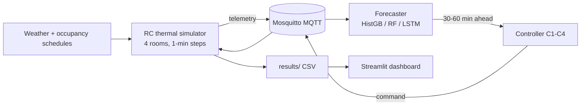

# Carbon- and Comfort-Aware Predictive Control for Smart Buildings

A simulated four-room building where virtual ESP32 sensors publish occupancy,
temperature, humidity and power over MQTT, a machine-learning forecaster predicts
occupancy and demand 30–60 minutes ahead, and a predictive controller schedules
HVAC and lighting from that forecast.

Course project for **MM0402A — IoT and Sustainability** (Group 5, guide
Prof. Vijaykumar Ghule).

> **Headline finding — the honest version.** The predictive controller does
> **not** beat fixed schedules on energy. It spends **0.3–2.5 % more energy** than
> the tuned setback baseline and buys **+3 to +6 percentage points of comfort-band
> compliance** in return. Two simpler baselines are cheaper; neither holds comfort
> as well. Carbon awareness did not shift load off-peak. Details in
> [Limitations](#limitations--honest-findings).

---

## Results

4 scenarios × 4 controllers × 5 random seeds. Comfort = share of occupied
minutes inside 22–26 °C and 30–60 % RH.

| Scenario | C4 energy (kWh) | Extra energy vs C3 | Comfort gain vs C3 | C4 comfort |
|---|---|---|---|---|
| weekday  | 25.23 | +0.28 % | **+2.97 pp** | 71.3 % |
| weekend  |  2.10 | +0.48 % | 0.00 pp | 72.7 % |
| heatwave | 28.08 | +2.49 % | **+6.09 pp** | 70.3 % |
| exam-day | 27.23 | +0.77 % | **+4.67 pp** | 75.2 % |

Baseline C2 (occupancy rule) is the energy winner — 1.6 % cheaper on a weekday,
2.0 % on a heatwave — but it drops comfort by 1.5–4.0 pp to get there.

Forecaster quality (walk-forward, held-out, no leakage):

| Target | Horizon | RMSE | MAE |
|---|---|---|---|
| demand (kWh) | 30 min | 0.046 | 0.019 |
| demand (kWh) | 60 min | 0.078 | 0.027 |
| occupancy (people) | 30 min | 0.924 | 0.294 |
| occupancy (people) | 60 min | 0.889 | 0.300 |

---

## Architecture



MQTT contract (one topic namespace per room):

```
building/{room}/telemetry        sensor readings, JSON
building/{room}/command/{hvac|light}
building/{room}/status           online/offline via last-will
```

Rooms: `classroom_A`, `classroom_B`, `office`, `lab`.

---

## Controllers

| ID | Policy | Uses forecast | Idea |
|---|---|---|---|
| C1 | Fixed schedule | no | Occupancy hours pre-programmed, runs regardless |
| C2 | Occupancy rule | no | Reacts to *current* occupancy |
| C3 | Setback | no | Wider deadband when unoccupied — the strong baseline |
| C4 | Predictive | **yes** | Pre-heats/cools before predicted arrival, relaxes early on predicted departure |

C4 is also run in two ablation modes: `c4-as-c3` (forecast disabled, must match
C3 exactly — a correctness check) and `c4-with` (full forecast + carbon signal).

---

## Repository layout

```
sim/        1R1C thermal model, occupancy, weather, grid carbon, metrics, run CLI
iot/        MQTT topics contract, paho client, ESP32 node model, telemetry bridge
ctrl/       C1-C3 baselines, C4 predictive policy, evaluation harness
ml/         walk-forward forecasting, HistGB/RF bake-off, LSTM, UCI adapter
eval/       experiment matrix, ablations, sensitivity, report + figures G1-G7
dashboard/  Streamlit viewer (7 tabs incl. Plotly 3D building twin)
viz/        Mesh3d building twin
scripts/    live MQTT demo, dashboard screenshot capture, scenario spot-checks
docs/       MQTT protocol notes, ThingSpeak/Blynk cloud guide
tests/      129 tests
```

---

## Quickstart

Verified on **Python 3.14.6** with the pins in `requirements.txt`
(`tensorflow==2.22.0-rc0`). Machines that must train the LSTM on a stable TF
release can use 3.12.x instead — nothing else depends on it, and `sim` prints a
cosmetic warning on non-3.12 interpreters.

```bash
pip install -r requirements.txt

# sanity check
python -c "import sim.thermal, sim.config; print(sim.config.BASE_TAU_HOURS)"

# tests
pytest tests/ -q
```

## Usage

```bash
# one simulation
python -m sim.run --scenario weekday --days 1 --seed 0

# full experiment matrix (4 controllers x 4 scenarios x 5 seeds)
python -m eval.matrix --seeds 5

# ablations (with/without forecast, with/without carbon signal)
python -m eval.ablate

# every report figure (G1-G7) and table
python -m eval.report

# dashboard
streamlit run dashboard/app.py     # http://localhost:8501
```

Live MQTT round trip (needs Mosquitto running):

```bash
mosquitto -c mosquitto.conf -v
python scripts/live_broker_demo.py --steps 30 --scenario weekday --start-minute 530
```

Full step-by-step reproduction, including the G7 screenshot: [`REPRODUCE.md`](REPRODUCE.md).
Pre-demo run order: [`DEMO-CHECKLIST.md`](DEMO-CHECKLIST.md).

---

## Limitations / honest findings

- **No energy win.** C4 is 0.3–2.5 % *more* expensive than C3. Its value is
  comfort, not savings. Any claim of beating fixed schedules on energy is not
  supported by the data.
- **No load shifting.** The carbon signal raised peak-hour share from 0.071 to
  0.080 instead of lowering it — the grid model's off-peak carbon advantage is
  too small to act on. Documented in [`SHIFTING-FINDING.md`](SHIFTING-FINDING.md).
- **Synthetic building.** A 1R1C lumped model, not EnergyPlus. Absolute kWh
  values are illustrative; controller *rankings* are the transferable result.
- **Simulated IoT.** ESP32 nodes are Wokwi/software models, not hardware.
- **No off-peak tariff optimisation** and no multi-zone coupling between rooms.

---

## Docs

| File | Contents |
|---|---|
| [`REPORT.md`](REPORT.md) | Full write-up: method, scenarios, all figures |
| [`REPRODUCE.md`](REPRODUCE.md) | Fresh clone → every figure and table |
| [`DEMO-CHECKLIST.md`](DEMO-CHECKLIST.md) | 15-minute live demo run order + fallbacks |
| [`SHIFTING-FINDING.md`](SHIFTING-FINDING.md) | Why carbon-aware shifting failed |
| [`docs/protocols.md`](docs/protocols.md) | MQTT topic contract, QoS, last-will |
| [`docs/thingspeak-guide.md`](docs/thingspeak-guide.md) | Optional cloud dashboard (manual, needs account) |

---

## License

Academic coursework — no license granted for reuse.
