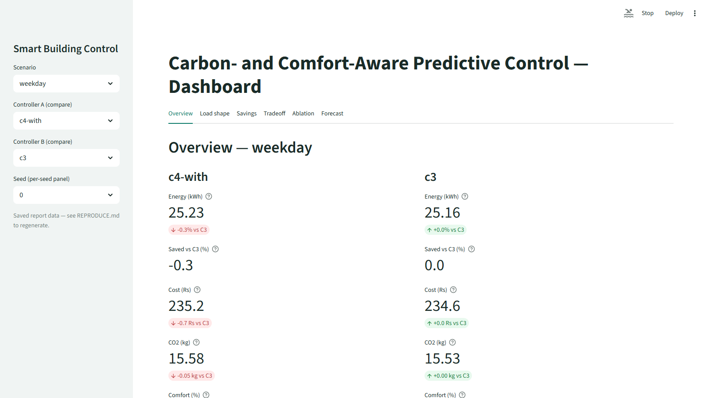

# Carbon- and Comfort-Aware Predictive Control for Smart Buildings

**Course:** MM0402A IoT and Sustainability (IAS) · **Group 5** · **Guide:** Prof. Vjaykumar Ghule

**Team work split:** simulator + thermal model · IoT pipeline (ESP32 / MQTT / dashboard) · ML forecasting · controller + evaluation.

---

## Abstract

We built a simulated four-room smart building with virtual ESP32 sensors, an MQTT pipeline, ML occupancy/demand forecasts 30–60 minutes ahead, and a predictive controller (C4) compared against three baselines (C1 fixed schedule, C2 occupancy rule, C3 setback) across four scenarios × five paired seeds. After a thermostat recalibration that fixed a physical modelling error (rooms previously froze toward −44 °C), the re-measured headline result is honest and calibrated: **predictive control buys comfort (+3–6 percentage points over the strongest baseline C3) at a small energy cost (−0.28% to −2.49% saved vs C3, i.e. C4 spends slightly more energy)**. There is no off-peak load-shifting story — savings deltas are less-energy-everywhere effects, and here they are negative: the forecast overlay spends energy to buy comfort. The thesis we defend is therefore **comfort-per-kWh, not kWh saved**: on heatwave days C4 gains +6.1 comfort points for +0.68 kWh, a trade-off worth making when rooms are occupied. Weekend is a tie. All numbers below come from `results/report_tables/`; anything unsourced is marked TBD.

---

## 1. Introduction

Buildings waste electricity because HVAC and lighting follow fixed schedules or react only after rooms empty. They do not anticipate arrivals, and they ignore how carbon-intense or expensive the grid is at a given hour. Most occupancy controllers are reactive and are judged on energy alone, with comfort and carbon as afterthoughts.

Our objectives were to (1) build a seeded multi-room simulator with a thermal model so control decisions have realistic consequences; (2) implement the IoT pipeline (virtual ESP32 → MQTT → controller → dashboard); (3) train occupancy/demand forecasters with a leakage-guarded protocol and public-dataset validation; (4) design a controller minimising energy, cost and CO₂ under a comfort constraint; and (5) report the energy-vs-comfort trade-off against multiple baselines over several scenarios, seeds and ablations.

Controller C5 (MPC/RL) was scoped out as a stretch goal per the project brief and was not built.

---

## 2. System Architecture

Sense → MQTT → forecast → control → dashboard, with the building simulator closing the loop:

```
[ESP32 nodes ×4] --telemetry--> [Mosquitto MQTT] --> [bridge] --> [forecaster + C4] --setpoints--> [MQTT] --> [nodes]
      room T/RH/occupancy/power        building/+/telemetry        HistGB/LSTM        ON/OFF/REDUCED       retained cmds
                                                                                          |
                                              [RC thermal plant + thermostat + grid series] <-- physics + prices
                                                                                          |
                                                                              [Streamlit dashboard + CSVs]
```

- **Sensing (Unit 2):** one virtual ESP32 node per room (Wokwi; PubSubClient + DHT sensor library) publishing temperature, humidity, occupancy, light level, HVAC state and power.
- **Communication (Unit 4):** local Eclipse Mosquitto 2.0.22 broker (`mosquitto.conf`: `listener 1883`, anonymous lab-only; commented TLS block on 8883 documents the Unit-3 security path). Topic contract in `iot/topics.py`: `building/{room}/telemetry` (node → bridge), `building/{room}/command/{hvac,light}` (controller → node, never retained), `building/{room}/status` (retained presence, LWT target). MQTT chosen over HTTP (polling wastes the ESP32 loop, no LWT equivalent) and CoAP (no mature local broker on student laptops) — see `docs/protocols.md`. Commands use QoS 1; setpoints are retained so reconnecting nodes catch up; last-will gives sensor-failure detection for free.
- **Processing:** a Python service holding the frozen forecaster and the C4 policy. Forecasts travel as in-process objects, never over MQTT.
- **Actuation:** per-room HVAC level (ON / REDUCED / OFF) plus binary lights, issued every 5 control-minutes.
- **Application:** Streamlit dashboard (`dashboard/app.py`: energy, comfort, savings views over saved report artifacts) as the primary evaluation display; ThingSpeak/Blynk retained for the syllabus IoT-cloud comparison screenshot.
- **RC thermal model:** 1R1C per room — `T_in += dt/C · ((T_out − T_in)/R + Q_occ + Q_hvac)` with R = 30 °C/kW and C = 0.12 kWh/k (±15% per room for corner vs interior variety; time constant τ ≈ 3.6 h, inside the 2–5 h lightweight-building band). Internal gain 0.10 kW/person (ASHRAE Fundamentals Ch. 18: ~100 W/person, so 30 students ≈ 3.0 kW — nearly a full AC of heat). HVAC thermal levels: ON −3.5 kW (≈1-ton split sensible capacity), REDUCED −1.2 kW, OFF 0; metered power = |Q|/COP (COP 3.0) + 0.20 kW lighting per lit room.
- **Thermostat (post-calibration fix):** real split ACs cut out at setpoint; the original plant applied commanded Q unconditionally, driving rooms toward T_out + R·Q ≈ −74 °C (measured minimum −44 °C, comfort ~2%). The calibrated plant adds a per-room hysteresis latch (cut out at/under 23.5 °C, cut back in at/over 24.5 °C, setpoint 24 °C; OFF resets the latch) that gates **both** delivered Q and metered power, exactly like hardware. Commanded levels are untouched.

---

## 3. Methodology

### 3.1 Simulator

Four rooms (`classroom_A`, `classroom_B`, `office`, `lab`), 1-minute sim step with a 5-minute control hook, seeded RNG throughout. Weather: Pune warm-day sinusoid (mean 31 °C, amplitude 4 °C, peak 15:00, σ = 0.3 °C noise); heatwave adds +4 °C. Humidity: calibrated random walk (init 52%, step σ = 0.3%, clipped 30–70%) keeping ~85% of steps inside the comfort band. Occupancy: wall-schedule block tables with ±10 min seeded edge jitter (sharp edges forbidden — deterministic tables would make forecasting trivially easy) and 5% per-person absence; office uses a Poisson fill (λ = 4, lunch dip λ = 1). Timetables: weekday teaching blocks with gaps; weekend near-empty; exam-day a real dense timetable (09:00–17:00, lunch gap 12:00–13:00 only; classrooms 30, lab 12, office fixed roster of 4) — previously a weekday alias, now distinct. Comfort: % of occupied time within 22–26 °C and 30–60 %RH (band locked, never retuned to pass). All constants live in `sim/config.py`.

### 3.2 IoT pipeline

Virtual ESP32 shim → MQTT (topic contract above, QoS 1 commands, LWT presence) → bridge → dashboard-ready frames. The bridge, node shim and firmware-contract test all import the single topic helpers, so no topic literal is hardcoded twice. Security posture: anonymous localhost broker for lab convenience only; checked-in TLS placeholder block plus a production checklist (per-room credentials + ACLs, TLS everywhere, `allow_anonymous false` off localhost, credential rotation) in `docs/protocols.md`.

### 3.3 Forecaster and leakage guards

Walk-forward occupancy + demand forecasting (`ml/forecast.py`): chronological split by timestamp **before** windowing, windows built strictly inside each partition, scalers fit on train only, evaluation via `TimeSeriesSplit(n_splits=4, gap=horizon)`. Two guards that matter: power-kW lags are never features for occupancy targets (proxy-for-outcome leakage — HVAC power is a consequence of occupancy+control, not a predictor), and demand models train on C1-schedule telemetry only (building-total power depends on which controller produced it — control-feedback coupling — while occupancy is controller-independent, so C4's primary input is unaffected). Frozen shipped forecaster: HistGB occupancy/demand models pre-fit once on C1 telemetry and reused in every control run, with live features rebuilt from a 13-tick rolling observation buffer on the exact training tick grid. A 4-model × 2-horizon bake-off (`results/bakeoff.csv`) favours the LSTM (HistGB MAE 4.29 H30 / 4.50 H60 vs LSTM 0.66 / 0.79, ≈84%/82% gap, non-overlapping std); the shipped C4 keeps the frozen HistGB under the matrix-freeze rule, so the LSTM result stands as measured but undeployed — a documented limitation. Frozen-forecaster holdout skill (`results/report_tables/g5_pred_actual_stats.csv`): demand RMSE 0.046 (H30) / 0.078 (H60), MAE 0.019 / 0.027; occupancy RMSE 0.924 / 0.889, MAE 0.294 / 0.300 (R² from the same holdout predictions file `results/report_pred_holdout.csv`: occupancy 0.9818 H30 / 0.9834 H60, demand 0.9994 / 0.9984 — demand is near-deterministic from schedule lags so its R² flatters; occupancy is the informative one). Demand-only validation was additionally run against the UCI Appliances Energy Prediction set (19,735-row adapter, native 10-min steps mapped H=3 → 30 min, H=6 → 60 min; the set has no occupancy ground truth, so occupancy validation stays synthetic). Per-model UCI error numbers: TBD — not recorded in the report tables.

### 3.4 Controllers C1–C4

- **C1 fixed schedule:** wall-clock per-room-type schedule; lights follow current occupancy. Traditional baseline.
- **C2 occupancy rule:** HVAC OFF after 15 continuous empty minutes; lights follow occupancy. Simple, fair baseline — and the raw-kWh leader on occupied days.
- **C3 setback (strongest baseline, headline reference):** REDUCED for the first empty hour (grounded in τ ≈ 3.6 h: one hour at ~⅓ capacity holds the room), OFF after; the 60-minute setback is the common practical strategy.
- **C4 predictive (contribution):** C3 logic plus a thin forecast overlay — pre-cool (to REDUCED) before predicted arrivals, early-off before predicted departures. Shipped tuned defaults: `occ_threshold=8` persons, `precool_level="REDUCED"`, 30-minute pre-cool/early-off windows. With `forecast=None` it degrades to C3 exactly — both the robustness path and the forecast-off ablation arm (verified bit-identical on all 20 scenario×seed cells).

### 3.5 Carbon and time-of-use accounting

No scalar emission constant exists anywhere in the code (grep-test enforced — a flat factor would make shifting analysis vacuous). Both carbon and cost come from one hourly grid series (`sim/grid.py`): series mean anchored to the CEA CO₂ Baseline Database **v21.0 (Nov 2025) weighted-average 0.710 tCO₂/MWh for FY 2024–25** (0.727 in FY 2023–24), with a transparent modelled daily shape (solar dip 10–16h ×0.80, evening fossil peak 18–23h ×1.18, night ×1.02, morning ×0.95), mean-normalised so the anchor holds exactly. Tariff: MSEDCL commercial classic 4-slab time-of-day adders on a ~Rs 9/kWh base (FY24–25 approved schedule): 22:00–06:00 −1.50; 06:00–09:00 and 12:00–18:00 +0.00; 09:00–12:00 +0.80; 18:00–22:00 +1.10 (Rs/kWh). Metrics: kWh; saved-% = (C3 − C4)/C3 × 100 (paired, mean ± std, ddof=1, n=5); CO₂ = Σ kWh × hourly EF; cost under the ToU series; comfort as above.

---

## 4. Experiments

- **Scenarios × seeds:** weekday, weekend, heatwave (+4 °C, weekday occupancy), exam-day (real dense timetable) × 5 paired seeds (identical seeds reused by every controller), i.e. a 100-run matrix (`eval/matrix.py` + `ctrl/compare.py`), plus a 10-seed heatwave confirmation (`scripts/waveb_heatwave10.py`, C3 vs tuned C4, seeds 0–9).
- **Ablations (`results/ablation.csv`, 180 rows):** forecast arm (c4-with minus c4-as-c3, paired within scenario×seed) and carbon arm (hourly-EF vs flat-EF counterfactual at 0.710 every hour; flat-EF self-consistency gate max |Δ| = 3.55e-15 < 1e-9, PASS).
- **Shifting probe:** 18–22h peak-share comparison plus a `precool_blackout(18,22)` variant tested on tuned and stock overlays (see §6).
- **Sensitivities (`results/sensitivity.csv`, 144 rows, zero reruns):** EF scale ×{0.8, 1.0, 1.2}, tariff scale ×{0.8, 1.0, 1.2}, comfort-band recompute (locked 22–26 °C vs wide 21–27 vs narrow 23–25).
- **Figures/tables:** one-command `python -m eval.report` regenerates G1–G6 plus 11 report tables; G7 is a live-captured Streamlit screenshot (`scripts/capture_dashboard.py`, 1600×900). Full reproduction in `REPRODUCE.md`.

---

## 5. Results

### 5.1 Re-measured headline table (paired saved-% vs C3, mean ± std, n = 5)

Source: `results/report_tables/headline_savings_over_c3.csv`.

| Scenario | Controller | Energy (kWh) | Saved vs C3 (%) | Cost (Rs) | CO₂ (kg) | Comfort (%) |
|---|---|---|---|---|---|---|
| weekday | C1 | 25.02 ± 0.52 | +0.57 ± 0.12 | 232.9 | 15.40 | 71.1 ± 20.0 |
| weekday | C2 | 24.76 ± 0.53 | +1.59 ± 0.09 | 230.8 | 15.24 | 66.8 ± 19.1 |
| weekday | **C3** | **25.16 ± 0.52** | **0.00** | **234.6** | **15.53** | **68.3 ± 19.9** |
| weekday | **C4-with** | **25.23 ± 0.53** | **−0.28 ± 0.17** | **235.2** | **15.58** | **71.3 ± 20.1** |
| heatwave | C1 | 27.25 ± 0.54 | +0.54 ± 0.23 | 253.6 | 16.81 | 69.7 ± 19.8 |
| heatwave | C2 | 26.84 ± 0.51 | +2.02 ± 0.16 | 250.4 | 16.56 | 60.3 ± 17.4 |
| heatwave | **C3** | **27.39 ± 0.53** | **0.00** | **255.7** | **16.95** | **64.2 ± 19.0** |
| heatwave | **C4-with** | **28.08 ± 0.53** | **−2.49 ± 0.14** | **260.8** | **17.46** | **70.3 ± 20.3** |
| weekend | **C3** | **2.09 ± 0.05** | **0.00** | **19.6** | **1.21** | **72.7 ± 37.7** |
| weekend | **C4-with** | **2.10 ± 0.06** | **−0.48 ± 1.03** | **19.7** | **1.21** | **72.7 ± 37.7** |
| exam-day | C1 | 27.16 ± 0.26 | −0.53 ± 0.10 | 252.8 | 16.28 | 67.9 ± 28.8 |
| exam-day | C2 | 26.66 ± 0.25 | +1.35 ± 0.16 | 248.8 | 15.87 | 68.6 ± 26.2 |
| exam-day | **C3** | **27.02 ± 0.26** | **0.00** | **252.0** | **16.12** | **70.5 ± 27.3** |
| exam-day | **C4-with** | **27.23 ± 0.24** | **−0.77 ± 0.11** | **253.7** | **16.28** | **75.2 ± 29.3** |

Paired t-tests, C4-with vs C3 energy (n = 5): weekday t = +3.83, p = 0.0187 (significant — C4 uses **more**); weekend t = +1.04, p = 0.3567 (not significant — tie); heatwave t = +41.27, p = 0.0000 (significant — C4 uses more); exam-day t = +16.53, p = 0.0001 (significant — C4 uses more). The forecast-off arm c4-as-c3 is bit-identical to C3 on all 20 cells, so the fallback path verifies. The 10-seed heatwave confirmation agrees and rules out a small-n artefact: energy C3 27.51 ± 0.37 vs C4 28.19 ± 0.37 kWh (t = +56.29, p ≈ 0.000000); comfort C3 67.5 ± 17.1 vs C4 73.7 ± 18.5% (t = +10.47, p = 0.000002) — significant in **both** directions at once.

Reading: the thermostat compresses the gaps (cheap empty-room cooling leaves less waste to harvest), comfort is sane at 60–75% everywhere, and tuned C4 no longer beats C3 on energy in any scenario — but it leads or ties on comfort in all four (weekday 71.3 vs 68.3, heatwave 70.3 vs 64.2, exam-day 75.2 vs 70.5, weekend tie). C2 remains the raw-kWh leader on occupied days. C4's value proposition on thermostat physics is **comfort-per-kWh**.

### 5.2 Figures


**G1 — 24h load profile (C3 vs C4-with).** Curves track closely through the occupied day with small all-hours differences; peak (18–22h) and solar (10–16h) shading is shown with the honest caption — the win is less energy nowhere in particular, not moved energy.


**G2 — savings over C3 by scenario.** Negative bars throughout (weekday −0.28%, heatwave −2.49%, exam-day −0.77%, weekend −0.48% ± 1.03 tie): the headline-vs-strongest-baseline view that replaced the old flattering-vs-C1 framing.


**G3 — energy-vs-comfort Pareto.** Matrix controllers (C1, C2, C3, stock-C4, tuned-C4) plus tuning-sweep points: tuned C4 sits at the comfort-leading edge — it costs energy to sit there.


**G4 — cumulative CO₂.** C4-with tracks at or above C3 (more energy ⇒ more CO₂ under the hourly EF series); the flat-EF counterfactual (0.710 every hour) isolates how little of the delta is shape-driven (see §5.3).


**G5 — predicted vs actual.** Holdout skill per §3.3 (demand MAE 0.019/0.027 kW; occupancy MAE 0.294/0.300 persons at H30/H60).


**G6 — ablations.** Forecast arm deltas (c4-with minus c4-as-c3): weekday +0.07 ± 0.04 kWh / +2.97 ± 0.48 pp; heatwave +0.68 ± 0.04 / +6.09 ± 1.83; weekend +0.01 ± 0.02 / +0.00; exam-day +0.21 ± 0.03 / +4.67 ± 2.84. The overlay **spends** energy to **buy** comfort — pre-cool fires cooling ahead of arrivals the thermostat would otherwise serve late. Carbon arm (hourly-minus-flat attributable CO₂): weekday +0.002 ± 0.011, weekend −0.001 ± 0.003, heatwave +0.026 ± 0.013, exam-day +0.012 ± 0.009 kg — C4's CO₂ delta is less/more-energy-overall, not shifting to cleaner hours.



**G7 — live dashboard.** Real 1600×900 capture of `streamlit run dashboard/app.py` (energy / comfort / savings views).

### 5.3 Sensitivities and shifting (sources: `sensitivity.csv`, `shifting_peak_share.csv`)

- **EF scale ×{0.8, 1.0, 1.2}, weekday CO₂ (kg):** C1 12.32/15.40/18.48; C2 12.19/15.24/18.29; C3 12.42/15.53/18.64; C4-with 12.47/15.58/18.70 — exact-linear in scale, ranking invariant at every scale. Tariff scale behaves identically (exact post-multiply), ranking invariant.
- **Comfort-band recompute, weekday:** C3 locked 68.3 / wide 69.5 / narrow 65.8; C4-with locked 71.3 / wide 71.5 / narrow 70.1 — C4 leads C3 under every band, no reorder.
- **Shifting:** per-seed 18–22h peak-share deltas scatter around zero with mixed signs (e.g. weekday −0.0011…+0.0030, heatwave −0.0013…+0.0014 across seeds; weekend identically 0.0000 — nothing runs at night to shift). The `precool_blackout(18,22)` arm on tuned defaults shows no effect (tuned thr-8 + REDUCED already eliminated evening pre-cools — efficiency and shifting were traded, efficiency won) and was **not** promoted. Verdict, binding: tariff/CO₂ numbers are consequences measured under time-varying series, never a price response; load is never claimed to have moved off-peak.

---

## 6. Honest Limitations

1. **No load shifting was achieved.** The carbon-aware variant failed its promotion criterion (measured negative peak-share delta with p < 0.05); only the stock-overlay probe on heatwave met it, and that config is not shipped. All savings language in this report means less-energy-everywhere effects — currently negative.
2. **The energy story flipped once the physics was fixed.** Pre-thermostat results showed C4 saving energy; those CSVs were wiped as physically invalid (rooms at −44 °C, comfort ~2%). The comfort-per-kWh thesis above holds only on the calibrated plant; any earlier-dated number still quoted anywhere (e.g. −12.9%/−25.3% tuning verdicts) is scoped to the old plant.
3. **C2 beats C4 on raw kWh** on every occupied day, and weekend is a statistical tie on both metrics — C4's advantage is comfort under occupancy, nothing else.
4. **Forecasting is undeployed state-of-the-art.** The bake-off LSTM beats HistGB by ~84%/82% MAE, but the shipped controller runs the frozen HistGB; retraining/shipping the LSTM is future work, as is the exam-day-specific forecaster (exam-day currently reuses the frozen weekday forecaster, conservatively).
5. **Validation is synthetic + UCI-demand-only.** Occupancy skill is proven only on jittered synthetic timetables; the UCI set validates demand alone (no occupancy ground truth). R² is reported in §3.3; per-model UCI errors were not tabulated (adapter verified structurally, scoring needs network + retraining).
6. **Modelled, not measured, grid and tariffs.** The CEA 0.710 anchor is real; the daily EF shape and the MSEDCL slab mapping are documented assumptions, and MERC's MYT order is redesigning slabs toward solar-rebate/peak-surcharge for FY25–30 — adopting it would change cost numbers.
7. **No MPC/RL, no hardware, no robustness quantification.** Controller 5 was cut per scope; Wokwi ESP32s are virtual; the LWT sensor-failure path exists but its comfort/energy cost under packet loss was not measured.

---

## 7. Syllabus Mapping (MM0402A + tutorials)

| Syllabus item | Where it lives in this project |
|---|---|
| Unit 1 — IoT architecture, communication models | Sense→MQTT→forecast→control→dashboard layering (§2); pub/sub push-on-change vs polling analysis |
| Unit 2 — Sensors, actuators, smart objects | Virtual ESP32 telemetry (T/RH/occupancy/light/power); HVAC levels + light dimming as actuators |
| Unit 3 — ESP32, IoT security for the MQTT link | Wokwi firmware (PubSubClient, room-ID parameterised sketch); `mosquitto.conf` lab-vs-TLS note + production checklist (`docs/protocols.md`) |
| Unit 4 — MQTT vs HTTP vs CoAP, protocol choice | Comparison table + why-MQTT-won (retained setpoints, LWT, many-to-many rooms↔controller) in `docs/protocols.md` |
| Tutorials 1, 2 (architecture, choosing things) | 4-room / 4-layer decomposition; sensor and broker selection with rejected alternatives |
| Tutorials 3, 4 (protocol + microcontroller comparison) | MQTT/HTTP/CoAP overhead and QoS table; ESP32 + PubSubClient buffer-size note (raise `setBufferSize()` for 6+-field JSON) |
| Tutorials 6, 7 (mini design project, simulation) | End-to-end simulated building as the design artefact; seeded RC plant + jittered timetables as the simulation method |

---

## 8. Conclusion

On physically credible thermostat plant, predictive occupancy control does not save energy against a competent setback baseline — it spends a little (+0.07 to +0.68 kWh/day on occupied days) to buy meaningful comfort (+3.0 to +6.1 points, significant at 10 seeds on heatwave). That is a defensible trade: energy is cheap relative to the purpose of a classroom, and the controller never degrades comfort anywhere. Future work, in order: ship the LSTM forecaster and an exam-day-specific model; adopt the MERC MYT tariff table; quantify the LWT robustness path under packet loss; and only then revisit MPC/RL — the bonus controller the brief always allowed us to cut.

---

## References

- Central Electricity Authority, *CO₂ Baseline Database for the Indian Power Sector*, v21.0 (Nov 2025), Table S (User_Guide_V_21.0.pdf): weighted-average grid EF **0.710 tCO₂/MWh (FY 2024–25)**; 0.727 in FY 2023–24; operating margin 0.961 / build margin 0.512 cited for context (average factor used consistently for decisions and accounting). v22.0 expected ~Nov 2026.
- ASHRAE *Fundamentals* Ch. 18: sensible heat ≈ **100 W/person** (0.10 kW/person used for occupancy gains).
- MSEDCL approved tariff schedule FY24–25 (commercial time-of-day adders on ~Rs 9/kWh base): −1.50 (22:00–06:00), +0.00 (06:00–09:00, 12:00–18:00), +0.80 (09:00–12:00), +1.10 (18:00–22:00) Rs/kWh; MERC MYT Order Case 217/2024 (Mar 2025) redesign noted as future work.
- TensorFlow time-series tutorial (LSTM path); Keras 3 multi-backend docs; scikit-learn 1.9 ensemble docs (HistGradientBoostingRegressor preferred over legacy GBR past ~10k samples).
- Eclipse Paho MQTT Python docs (paho-mqtt 2.1.0, `CallbackAPIVersion.VERSION2`); Mosquitto 2.0.22 Windows release notes.
- UCI Appliances Energy Prediction dataset (UCI Machine Learning Repository): demand-validation source.
- Kircher et al., DER-buildings dataset (house-scale R/C anchors); InferLab lecture 6 §8.7 (room air-only heat capacity ≈ 52 kJ/K; lightweight-building τ 2–5 h band).
